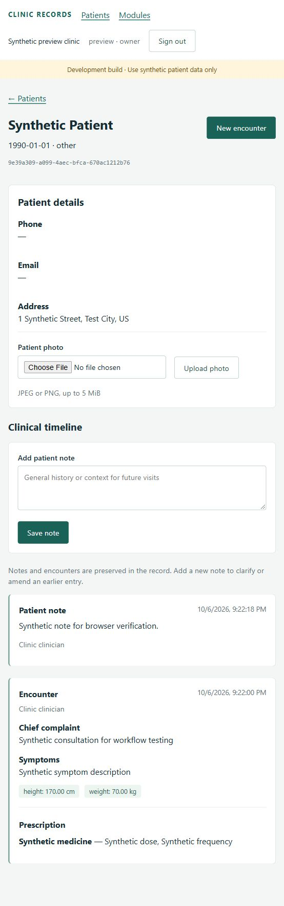
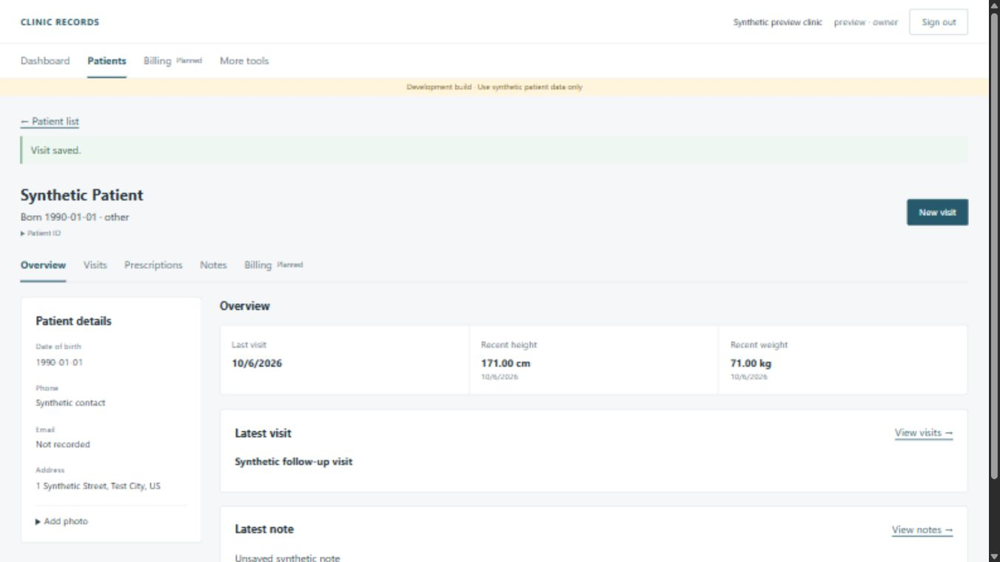

# Verification record

Newest first. The first entry on this page ("Initial MVP") is the oldest and is kept as it was written.

## Initial MVP

Verified on October 6, 2026 (America/New_York) in a Windows development environment.

| Check | Result |
| --- | --- |
| PostgreSQL 16 migrations | All migrations applied to an empty database |
| Backend suite on PostgreSQL | 32 tests passed, no skips |
| Fast SQLite backend suite | 30 passed; 2 PostgreSQL-only trigger checks skipped as designed |
| Migration drift | No changes detected |
| Django system checks | No issues |
| React/TypeScript build | Passed |
| Frontend tests | 5 passed across 2 files |
| npm dependency audit | 0 known vulnerabilities at verification time |
| Browser smoke test against PostgreSQL | Login, patient registration/address, note entry, encounter with height/weight and prescription, search and logout passed |
| Secret/build-file exclusion | Local `.env`, virtual environment, tooling, database, media, npm cache, dependencies and build outputs ignored |

Docker was not installed on the verification host, so Compose image builds and service startup were not executed here. The PostgreSQL checks used the official portable PostgreSQL server in an isolated loopback-only development instance. The temporary preview and database were stopped after verification. CI is configured to repeat PostgreSQL and frontend checks on a future repository push; no remote repository was created or pushed.

Only synthetic data was used. The screenshot below records the verified timeline, with a fictional patient, address, note and prescription. It is not a treatment recommendation.

Envelope encryption remains unimplemented. The production startup guard and the documented deployment gates remain in force. Test success does not establish production readiness or regulatory compliance.

## Every screen in the mockups (2026-10-11)

Run on the development PC (Windows 11) after the last change of the day.

| Check | Result |
| --- | --- |
| Backend suite on SQLite | 315 tests passed |
| Backend suite on PostgreSQL 16, with the trigger tests | 315 passed, 1 skipped by design |
| Migrations from a database that already held rows, both engines | Applied; rows kept; guards back in place |
| Ruff, migration drift | Clean |
| Frontend: ESLint, Prettier, TypeScript, build | Clean (the build warns that one script file is larger than 500 kB) |
| Frontend unit tests | 90 passed in 13 files |
| Browser tests, development stack (Vite, Django, PostgreSQL) | 11 passed, from an empty database |
| Browser tests, one-program app (waitress, built screens, SQLite) | 11 passed, from an empty data folder |
| GitHub checks | Green on the last push of the day (see below for two that failed first) |

**What the browser tests do.** Set the clinic up; register patients; record a visit by envelope and amend it; back up and read the backup back; search the library; make a price list, a walk-in sale by scanned barcode and a patient bill with a part payment; print the bill, a receipt, envelope labels, the patient card, a prescription and the day sheet to PDF and check each page count and paper size; import patients from a spreadsheet; save a work week, book by phone number, add a new caller, a walk-in, cancel; write a message from a template, send it through a stand-in for WhatsApp, fail and retry it, run a campaign, note a reply; invite a doctor, sign in with the one-time password, choose a password, set up two-step sign-in with a real code, reset, switch off, make a new recovery key and use it to reset the owner's password.

**Printing was checked as PDF only.** No paper printer and no thermal label printer was available. The label page is 2 × 2 inches (144 × 144 points) and 50 × 25 mm in the PDF; whether a particular label printer feeds it straight has to be tried on that printer with the test label on the Printers page.

**WhatsApp was not contacted.** The tests answer `https://wa.me/` with a stand-in page and check the address the application opens. Opening the real link in WhatsApp was not tried.

**Two-step sign-in** was checked against the published examples of RFC 6238 and with codes computed by the test; no phone app was used.

**Found and fixed while checking.**
- The development and browser-test server kept one database connection per browser connection and never reused them, so a long run reached PostgreSQL's limit of 100 and requests failed. Connections are now kept open only outside debug mode.
- The browser tests exceeded the limit of 300 requests a minute per user. The limit stays; the test servers raise it.
- Two tests took "today" from the computer instead of the clinic and failed for the hours each day when India is a date ahead.
- One browser test asserts on today's print queue and fails if the clinic's midnight passes between printing and looking (seen once on GitHub at 23:58 India time). Left as it is.
- On GitHub's machines the visit step once took longer than five seconds; the cause was not established. The step now waits longer, and failed runs keep their traces.

**Not checked.** Docker Compose. macOS and arm64 builds. The installers built from this state (the last installers are v0.1.1). Real patient data, which the application still refuses: no patient field is encrypted yet.

## Reference library: full Boericke and Kent's Repertory (2026-10-11)

174 backend tests pass on SQLite and PostgreSQL 16 (24 in `backend/knowledge/tests/`); Ruff clean; no migration drift. 29 frontend tests, ESLint, Prettier and the build are clean. 5 browser end-to-end tests pass on both setups. The SQLite suite now takes about 13 seconds instead of one, because three tests read the whole shipped library.

Imported from homeoint.org: all 687 remedies of Boericke's Materia Medica, and 67,178 rubrics of Kent's Repertory with 462,993 graded remedy entries across 38 chapters. Every abbreviation used in a rubric is placed on a remedy except three, which are left out: `gent` (16 uses; Kent lists two Gentianas), and two stray words. 141 remedies that Kent names and Boericke has no entry for have a name-only file.

Measured on the development PC: reading and indexing the library takes about 4 seconds once; after that a one-word search over everything ("pain", 692 remedies) takes about 60 ms and typical three-symptom searches under 15 ms. Not measured on the clinic's laptop.

**Compared with the source page:** Arnica in Boericke, and in Kent the rubric "Head, pain, sun, from exposure to" and page 130 to 131 of the Head chapter (names, nesting and grades). **Not compared:** everything else. Matching Kent's remedy names to Boericke's entries is by rule (same abbreviation, same name, natrum/natrium and kali/kalium spellings, or the only entry whose name starts the same way, such as Borax for Borax veneta); those matches were not reviewed one by one. Cross-references ("See ...") in the repertory are not imported.

Ranking favours remedies with many entries when several match equally: "bruised" alone lists Sulphur before Arnica. Results still show every reason, and a clinic's own choices move its remedies up.

## Reference library (2026-10-11)

172 backend tests pass on SQLite and on PostgreSQL 16 (21 of them new, in `backend/knowledge/tests/`); Ruff clean; no migration drift (the library adds no tables). 29 frontend tests pass (4 new); ESLint, Prettier and the build are clean. 5 browser end-to-end tests pass on the development servers and on the one-program app; the new one searches the shipped library, reads the antidotes of Arnica, and chooses a remedy on the visit page and sees it remembered.

The new tests cover: files reading back exactly as written; the clinic layer adding, hiding and creating entries while the shipped files stay byte for byte unchanged; an unreadable file reported and skipped; edits seen without a restart; every part of a query explained with its lines and sources; spelling variants, synonyms and unfinished words; the `anti+`, `comp+` shortcuts; a choice moving a remedy up for its clinic only; typed text that is not a library word never reaching the preferences file; an unreadable preferences file left untouched; roles (reception and billing refused and the refusal audited, assistants read-only); one clinic never seeing another's layer, learning or export; search refused in the address; the export's contents and its audit entry.

**Compared with the source page:** Arnica only (antidote Camphora; complementary Aconite and Ipecacuanha; modalities). **Not compared:** the other 34 remedies. The importer splits the book's sentences and reads its Relationship paragraphs by rule; the parsed output of about ten more remedies was read for plausibility and showed one stray note (Aconite's Quebracho entry). The full Relationship paragraph is kept verbatim in each file's notes so nothing is lost.

The PostgreSQL run used a separately named test database because `test_clinic` already existed. The full suite passed there but could not drop its test database afterwards ("2 other sessions using the database"); the library tests alone, and the accounts, records, audit and vault tests alone, pass and tear down cleanly. The cause was not found.

## Laptop UX revision

The subsequent laptop interface revision passed the frontend build and seven frontend tests. Browser verification at 1366 × 768 used synthetic fixtures in a temporary local database and covered the dashboard, patient tabs, preserving a note draft across tabs, the unsaved-navigation warning, saving a note, creating a visit and returning to Visits with confirmation. No backend schema or permission changes were made in this revision.

See [the UX decisions and flows](user-experience.md). Billing remains an inactive placeholder. Temporary preview servers and fixtures were removed after verification.

## Phase 1 step 1 (2026-10-10)

| Check | Result |
| --- | --- |
| Fast SQLite backend suite | 53 tests: 51 passed, 2 PostgreSQL-only trigger checks skipped |
| Backend suite on PostgreSQL | **Not run.** This PC has neither PostgreSQL nor Docker. The three new migrations only add columns and relax one validator; they do not touch triggers |
| Migration drift, Django system checks | No changes detected; no issues |
| TypeScript build | Passed |
| Frontend tests | 13 passed across 3 files |
| Browser check | Throwaway SQLite database with a synthetic clinic set to Asia/Kolkata, at a moment when the clinic's date was one day ahead of UTC |

The browser check confirmed: a date of birth of the clinic's today was accepted and tomorrow refused; `archived_at` sent in a PATCH was ignored; archive and restore worked and were audited; a session ended on the server produced the lock screen on the next save, a wrong password was refused, the right one unlocked, and the unsaved note was still in the field; the failed unlock appeared in the owner's audit log as a failed sign-in; clinic settings loaded and the audit log listed events with outcome, record and source address. The throwaway database and servers were removed afterwards.

CI has still never run because the repository has no remote.

## Tooling and PostgreSQL (2026-10-11)

| Check | Result |
| --- | --- |
| Backend suite on PostgreSQL 16.15 | 73 passed, none skipped. This is the first PostgreSQL run of migrations `accounts.0003`, `audit.0002` and `records.0003` to `0005`, including the guard triggers on patient codes and demographic history |
| Fast SQLite backend suite | 73 tests: 69 passed, 4 PostgreSQL-only checks skipped |
| Ruff lint and format check | Clean. Migration files are byte-identical to before linting |
| ESLint, Prettier check, TypeScript build | Clean |
| Frontend unit tests | 13 passed |
| Browser end-to-end (Playwright, Chromium, 1366 × 768) | 2 passed against a fresh PostgreSQL database: sign in, register a patient and see the card code, record a visit with a prescription, find it in the audit log, sign out; and a refused wrong password |
| Docker Compose | **Not run.** Docker Desktop 4.94 is installed but has not been started; its first launch and licence acceptance are the owner's |
| CI | **Never run.** The repository has not been published to GitHub. The new lint and end-to-end CI jobs are therefore unverified |

PostgreSQL note: the Windows installer placed the programs in `C:\Program Files\PostgreSQL\16` but its step that creates the database service failed, most likely because the generated superuser password began with a character the installer's script read as an option. No service exists. Development uses a private database in `.tools/pgdata` started by `scripts/dev_db.py`, which needs no service or admin rights.

## Release v0.1.1 and the envelope visit screen (2026-10-11)

- **GitHub:** the ordinary checks pass. The packaging build passed on Windows x64, macOS Apple silicon, Linux x64 and Linux arm64, each running the browser tests against its own built program, and produced a draft release with eight files. Windows arm64 and Intel Mac were removed after failing: the `cryptography` library has no ready-made build for them.
- **Mac, by the owner on an M4:** the app opened after allowing it in Privacy & Security (it is unsigned), and the menu-bar icon and its menu worked.
- **Envelopes and remember notes:** 179 backend tests on SQLite and on PostgreSQL (exit status checked), 31 frontend tests, 5 browser tests including a two-medicine envelope with its dosage line and a remember note.
- **Migration against existing records:** `records.0006` was run on SQLite and PostgreSQL databases that already held a visit, a note and a prescription; rows were kept and every guard was present afterwards. This check found that the SQLite guards blocked any table rebuild; fixed by removing them before a migration and restoring them after.
- **Not done:** the Windows and Linux builds in the v0.1.1 draft predate the envelope screen; nobody has used the new visit screen by hand.

## Jivni: tray application, installers and portable builds (2026-10-11)

*The application was renamed from DocHP to Jivni at this point. Sections below this one were written before the rename and keep the old name and paths.*

| Check | Result |
| --- | --- |
| Backend suite after the rename | 151 passed on SQLite; 151 passed on PostgreSQL 16 with 1 SQLite-only check skipped |
| Application start, stop, start again; listens on 127.0.0.1 only | Passed (automated) |
| Tray menu contents and actions, running and stopped | Passed (automated, without a desktop) |
| Packaged Windows program in tray mode | Started, served the health check, the setup check, an application page and the logo; no "no system tray" fallback was logged. **The menu itself was not clicked by a person** |
| Browser tests against the packaged Windows program | 4 passed |
| Windows portable zip | Unzipped to a temporary folder, ran, and kept its data in `Jivni-Data` beside the program; nothing was written to the user's application-data folder |
| Windows installer | Silent install to a temporary folder: program installed, Start-menu entry created, no desktop shortcut when not asked for, installed copy served; silent uninstall removed the program and the Start-menu entry and **left the data folder intact** |
| Linux x64 build (made in WSL, Ubuntu 24.04) | Browser tests for first-time setup, the visit flow and a refused password passed against it (3 of 3; the backup test was not run because the test harness passes a Windows folder path) |
| Linux `.deb` | Package metadata and file list checked (`/opt/jivni`, `/usr/bin/jivni`, desktop entry, icon); the program extracted from it started and served |

**Not verified, stated plainly:**

- macOS builds, Windows arm64 and Linux arm64: none exists yet. They cannot be built on this PC.
- The packaging workflow on GitHub: never run.
- On the Linux build in WSL there is no system tray; the tray library logged an error and the application carried on serving without an icon. On a Linux desktop without tray support there is then no menu to quit from; starting Jivni again opens the browser, and `--no-tray` in a terminal is the reliable way to run it there.
- The `.deb` was not installed with `dpkg -i` (that needs an administrator password); it was unpacked and run.
- Nothing is code-signed. Windows SmartScreen and macOS Gatekeeper will warn.
- Installing over a running copy, and updating from one version to the next, were not tried.

## SQLite and the installed app (2026-10-11)

| Check | Result |
| --- | --- |
| Backend suite on SQLite | 144 passed, none skipped. The database-trigger tests now run on SQLite too |
| Backend suite on PostgreSQL 16 | 144 passed, 1 skipped (a SQLite-only check that guards survive a table rebuild) |
| Browser tests against development servers (PostgreSQL) | 4 passed |
| Browser tests against the one-program app (`launcher.py`, SQLite, built frontend, empty data folder) | 4 passed |
| Browser tests against the packaged Windows program (`dist/DocHP/DocHP.exe`, 88 MB) | 4 passed |
| Restore of a backup made by the app on SQLite | Restored into a new PostgreSQL database and into a new SQLite database; both returned 1 clinic, 1 user, 1 patient, 1 visit, 26 audit events |

**Not verified:** Mac, Linux and arm64 packages (the recipe is the same, but it has only been run on Windows x64); the packaging and test workflows on GitHub (never run); Docker (Docker Desktop has not been started); behaviour with several people saving at once on SQLite; a real installer with shortcuts. The packaged program still shows a console window.

## First-time setup (2026-10-11)

137 backend tests pass on PostgreSQL 16; 25 frontend tests pass. The browser end-to-end run now starts from an **empty database**: the first test sets the clinic up through the real setup screen with a randomly generated password, sees a well-formed recovery key, cannot continue until the tick box is ticked, lands in the workspace, signs out and sees the ordinary sign-in. The later tests sign in with that account, register a patient, record a visit, scan the card, make a backup and check it. The restore drill was repeated on that backup and passed (1 clinic, 1 user, 1 patient, 1 visit, 34 audit events).

Backend tests also confirm: setup runs only once; a second attempt creates nothing; invalid input creates nothing; the owner is not a Django superuser; and the recovery key appears in no database table.

## Backups and a restore drill (2026-10-11)

| Check | Result |
| --- | --- |
| Backend suite | 130 tests pass on PostgreSQL 16 and on SQLite (4 PostgreSQL-only checks skipped there) |
| Frontend unit tests, lint, format, build | 22 passed; clean |
| Browser end-to-end | 3 passed: the owner adds a backup folder, backs up and runs the read-back check through the real screen; the test confirms the file exists and contains neither the clinic name nor the username |
| Restore drill | **Passed.** The backup made through the browser was restored by `scripts/restore_drill.py` into a newly created PostgreSQL database using the owner password: 1 clinic, 1 user, 1 patient, 1 visit and 29 audit events came back in about one second |

The backup tests cover: backup then restore into an empty installation with identical IDs, patient code, visit text, audit count, photo bytes, passwords and clinic key; refusal to restore over existing data; opening by password, by recovery key and by the session's clinic key; a flipped byte anywhere, a cut-short file and appended data all detected; no readable names, clinical text, photo bytes or keys in the file; backups without anyone signed in; removed staff absent from later backups; copying to several places with per-place failures; schedule and overdue rules; retention that never deletes the newest backup or a file the application did not name; owner-only access.

Not yet done: the drill used synthetic data on the development PC and a staff password. Before going live it must be repeated on the clinic's computer, with the recovery key, on a backup of realistic size. Automatic scheduling inside the app does not exist yet.

## Scan routing (2026-10-11)

108 backend tests pass on PostgreSQL 16; 19 frontend tests pass; the browser end-to-end test now types a patient card code at scanner speed on a page with no field in use and lands on that patient. Not tested with a physical scanner; the 50 ms gap between characters is an assumption to confirm with the clinic's device.

## Encryption key system (2026-10-11)

105 backend tests pass on PostgreSQL 16 and on SQLite (4 PostgreSQL-only checks skipped there); Ruff clean; no migration drift; 13 frontend tests and the 2 browser end-to-end tests pass with a clinic key created by the real sign-up command and unlocked at sign-in with production Argon2id settings.

The 32 new tests cover: a tampered cost setting locking instead of stalling the server; round trips for empty, Unicode and one-megabyte values; rejection of any changed byte, truncation, wrong clinic, wrong record, wrong field, wrong key and missing key version; moving a value to a new clinic key without changing its data ciphertext; password and recovery key opening the same clinic key; a grant copied onto another person's row opening nothing; revoking destroying the sealed copy; password change re-sealing the grant without touching data; a spent recovery key no longer working; the session needing both the cookie and the server half; another user's cookie not unlocking; and the four key-management commands.

**Not done and not claimed:** no patient field or file is encrypted yet, and nobody independent has reviewed this code.

## Phase 2 groundwork (2026-10-10)

Patient codes, scan lookup, reissue, WhatsApp number, duplicate check and demographic history: 70 backend tests, 67 passed and 3 PostgreSQL-only trigger checks skipped; 13 frontend tests passed; TypeScript build passed; no migration drift. The data migration that issues codes to existing patients was run forwards and backwards on a throwaway SQLite database. **Not verified on PostgreSQL:** migration `0005_patient_code_guards` attaches the two existing guard functions to the new tables with the same statement form as migration `0002`, but it had not been executed against PostgreSQL at that time. It passed on 2026-10-11; see above.
